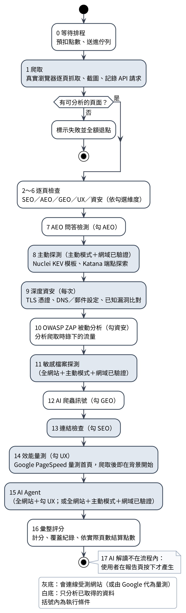

# 系統手冊：9-2 補充段落與附錄三「掃描階段與檢測項目」

> 用途：貼進「115資訊系統專案設計 系統手冊」docx。
> 來源：[`docs/scan-stage-checks.md`](../docs/scan-stage-checks.md)，依手冊讀者精簡：拿掉程式檔名、內部步驟併入相鄰階段、歷史修正註記刪除，保留每項檢查的判定標準與嚴重度。
> 事實版本：程式規則版本 2026.10.12（`backend/apps/scans/versions.py`）；改了規則、門檻或嚴重度時，先改 `docs/scan-stage-checks.md`，再同步本檔。
> 表號沿用手冊附錄慣例：附錄一＝表 A、附錄二＝表 B，本附錄＝表 C。

---

## 一、放進 9-2「診斷方法與適用範圍」的段落（接在表 9-2-2 之後）

掃描依固定順序執行十七個階段。表 9-2-3 列出各階段的執行條件與是否連線到受測網站；各階段的檢測項目、判定標準與嚴重度見附錄三。

**表9-2-3 掃描階段總表**

| 階段 | 執行條件 | 是否連線受測網站 |
|---|---|---|
| 0 等待排程 | 每次 | 否 |
| 1 爬取 | 每次 | 是，真實瀏覽器 |
| 2～6 SEO／AEO／GEO／UX／資安逐頁檢查 | 依勾選維度 | 否，只分析爬取結果 |
| 7 AEO 問答檢測 | 勾 AEO | 否 |
| 8 主動探測 | 主動模式＋網域已驗證 | 是 |
| 9 深度資安 | 每次 | 是，僅 TLS 與 DNS |
| 10 OWASP ZAP 被動分析 | 勾資安 | 否，分析已錄流量 |
| 11 敏感檔案探測 | 全網站＋主動模式＋網域已驗證 | 是 |
| 12 AI 爬蟲訊號 | 勾 GEO | 否 |
| 13 連結檢查 | 勾 SEO | 是 |
| 14 效能量測 | 勾 UX＋平台設定 PageSpeed 金鑰 | 由 Google 代為量測 |
| 15 AI Agent | 全網站＋勾 UX；或全網站＋主動模式＋網域已驗證 | 是，真實瀏覽器 |
| 16 彙整評分 | 每次 | 否 |
| 17 AI 解讀 | 使用者在報告頁按下才產生 | 否 |

被動模式只會連線到受測網站做第 1、9、13 階段的讀取，以及勾 UX 時的第 15 階段擬真操作（網域未驗證時不送出表單）；第 8、11 階段與深度資安 Agent 必須是主動模式、使用者授權且網域已驗證才會執行。

圖 9-2-1 依執行順序畫出各階段與執行條件，灰底為會連線受測網站的階段。

---

## 二、附錄三 掃描階段與檢測項目

本附錄依執行順序說明每個掃描階段的檢測項目、判定標準與嚴重度，內容對應程式規則版本 2026.10.12。規則版本不同的兩次掃描，分數不直接比較增減（見 9-2「評分與結果統計」）。

### C-1 嚴重度與扣分

SEO、AEO、GEO、UX、資安五個逐頁階段不連線、不開瀏覽器，只把爬取階段收集的 HTML 與量測結果拿來比對規則；耗時的工作（開頁、等渲染、截圖、行動版量測、無障礙檢查）都在爬取階段每頁做一次，因此這五個階段通常只需數秒。

**表C-1 嚴重度與扣分權重**

| 嚴重度 | 扣分權重 | 例子 |
|---|---|---|
| 嚴重 | 60 | 憑證已過期、外洩的環境變數檔、確認可利用的注入 |
| 高 | 35 | 外洩身分證號或信用卡號、弱 TLS、SPF 設為 +all |
| 中 | 12 | 缺 HSTS、表單缺 CSRF token、Cookie 未設 Secure |
| 低 | 4 | 缺 CSP、缺 Open Graph、觸控目標過小 |
| 資訊 | 0 | 僅提醒，不扣分 |

資安發現另標四種類型：設定建議、曝露面、疑似弱點、已驗證弱點，並對照 OWASP Top 10:2025 類別與 CWE 編號。

### C-2 等待排程與驗證目標

任務建立後先預扣點數，送進背景佇列等待掃描程式接手。開始前再次確認網址是公開的 http／https 網址；localhost、內網 IP、網址內含帳密、非 80／443 埠一律拒絕，避免平台被用來攻擊內部網路。

### C-3 爬取

以真實 Chromium 瀏覽器走訪同一個網站的頁面，後續所有逐頁檢查只使用這裡收集的資料。

**表C-2 爬取範圍**

| 項目 | 規則 |
|---|---|
| 範圍 | 單頁只看輸入的網址；全網站最多 50 頁、深度 6 層 |
| 同網站 | 只走同一協定、網域與連接埠 |
| sitemap | 全網站模式先讀 robots.txt 宣告的 sitemap（或 /sitemap.xml）補充起點 |
| robots.txt | 預設遵守 Disallow，被禁止的頁面不爬並記錄 |
| 速度 | 被動模式每秒最多 5 個請求，主動模式 2 個 |
| 不爬 | Cloudflare 的 /cdn-cgi/ 陷阱連結、超大檔案 |

每頁收集：HTTP 狀態碼與回應標頭、原始 HTML 與執行 JavaScript 後的 HTML（等畫面穩定，最多 5 秒）、載入時間、版面位移（CLS）、整頁截圖、axe-core 無障礙檢查（WCAG 2.0／2.1／2.2 A 與 AA）、未捕捉的 JavaScript 錯誤、手機寬度下的破版與觸控目標、頁面自己發出的同網站 API 請求，以及 robots.txt、llms.txt、sitemap 原文。

**被阻擋的判斷**：401、403、429、Cloudflare 驗證頁與超大頁面標為「被阻擋」，不拿來分析但保留截圖供核對；僅內嵌 Turnstile 表單元件的正常頁面不算被阻擋。一頁都抓不到時整個掃描標示失敗並全額退點，不產生看似正常的分數。

爬取後只用已抓到的資料辨識網站特徵（CMS、前端框架、伺服器、CDN、登入頁、API、檔案上傳），只記錄、不影響掃描與計分。

### C-4 SEO（逐頁）

登入、註冊、後台頁面與 PDF 等檔案不檢查。

**表C-3 SEO 檢查**

| 檢查 | 判定標準 | 嚴重度 |
|---|---|---|
| 標題長度 | 少於 10 或超過 65 字元 | 低 |
| Meta description | 沒有，或少於 50／超過 160 字元 | 低 |
| H1 | 沒有 H1 為低；超過一個為資訊（HTML 與 Google 都允許） | 低／資訊 |
| 圖片替代文字 | 圖片沒寫 alt 為低；3 張以上大圖 alt 為空為資訊 | 低／資訊 |
| canonical | 沒有 canonical 標籤 | 資訊 |
| Open Graph | 缺 og:title、og:description、og:image、og:url 任一項 | 低 |
| 結構化資料必填欄位 | 有 JSON-LD，但缺 Google 複合式搜尋結果要求的必填欄位（依 Google Search Central） | 低 |
| 自評星等 | 商家在自己網站標示的評分，Google 不會顯示為搜尋星等 | 資訊 |

### C-5 AEO（逐頁）

檢查內容能否被搜尋引擎與 AI 摘要、引用；AEO 分數主要來自 C-10 的問答檢測。

**表C-4 AEO 逐頁檢查**

| 檢查 | 判定標準 | 嚴重度 |
|---|---|---|
| 不可被索引 | meta robots、googlebot 或 X-Robots-Tag 含 noindex | 中 |
| 禁止摘要 | nosnippet 或 max-snippet:0 | 中 |
| 部分段落禁止摘要 | 有 data-nosnippet 區塊 | 資訊 |
| JSON-LD 語法錯誤 | 結構化資料無法解析，整段會被忽略 | 中 |
| 標記與頁面不一致 | 結構化資料的電話、地址、價格等值在頁面可見文字中找不到 | 低 |

### C-6 GEO（逐頁）

檢查內容是否容易被生成式 AI 理解與引用。

**表C-5 GEO 逐頁檢查**

| 檢查 | 判定標準 | 嚴重度 |
|---|---|---|
| 沒有結構化資料 | 頁面沒有任何 JSON-LD | 低 |
| 實體類型不明確 | 有 JSON-LD，但沒有 Organization、LocalBusiness、Article、Product 等明確類型 | 資訊 |
| 可引用段落偏少 | 成句段落少於 2 段，或正文不到 300 字 | 資訊 |
| 內容依賴 JavaScript | 執行 JS 後正文 ≥400 字，但原始 HTML 不到一半（多數 AI 爬蟲不執行 JS） | 中 |
| 沒有主內容區塊 | 沒有 main 標籤 | 低 |
| 段落過長 | 有超過 1000 字的段落 | 低 |
| 長文沒有小標題 | 正文約 1500 字以上卻沒有 h2～h6 | 低 |
| 列舉沒用清單 | 同一段有 3 個以上編號 | 資訊 |
| 缺少權威來源引用 | 有篇幅的正文頁沒有連到政府、學術等權威來源，也沒有參考資料區塊 | 低 |
| 缺少量化數據 | 有篇幅的正文頁幾乎沒有百分比、金額等具體數字 | 資訊 |
| 缺少可引用引言 | 有篇幅的正文頁沒有引言或署名引述 | 資訊 |
| 內容可能過時 | 出現兩類以上會變動的內容（過去年份、軟體版本、定期價格等）卻沒有更新日期 | 資訊 |
| 區段偏長不利分塊 | 平均每個小標題區段超過約 280 字，AI 難以逐段擷取 | 資訊 |

權威來源、量化數據、引言三項依 Princeton「GEO: Generative Engine Optimization」（KDD 2024）的內容訊號，只對有一定篇幅的正文頁判定，屬軟性建議、不重扣分。

### C-7 UX（逐頁）

量測在爬取時完成，本階段把量測結果轉為問題；觸控目標、缺標籤欄位與破版元素會在行動版截圖上框出實際位置。

**表C-6 UX 檢查**

| 檢查 | 判定標準 | 嚴重度 |
|---|---|---|
| 行動版破版 | 手機寬度下出現水平捲動；溢出達螢幕寬一半升為中 | 低／中 |
| 版面位移（CLS） | 依 Google CLS 定義：>0.1 為低、>0.25 為中，並列出位移最多的元素 | 低／中 |
| 觸控目標過小 | 手機上可點元素寬或高小於 40px；5 個以上升為中。句中的文字連結不算（WCAG 2.5.8 例外），包在 label 內的勾選框以整個 label 計算 | 低／中 |
| 表單欄位缺標籤 | 輸入欄位沒有 label、aria-label、title 或 placeholder | 中 |
| 假按鈕 | 以 div／span 加點擊事件當按鈕卻沒有 role，螢幕報讀與鍵盤無法使用 | 低 |
| JavaScript 錯誤 | 頁面有未捕捉的例外 | 中 |
| WCAG 無障礙（axe-core） | 色彩對比不足、按鈕或連結沒有名稱、未設頁面語言等；axe 判定 critical、serious 為中，其餘為低 | 低／中 |

### C-8 資安（逐頁）

登入與後台頁面也會檢查；Email 與手機的格式判斷與 AEO 共用，兩邊結論不會互相矛盾。

**表C-7 資安逐頁檢查**

| 檢查 | 判定標準 | 嚴重度 |
|---|---|---|
| CSRF | 會改變狀態的表單（POST 或含密碼欄位）沒有 CSRF token；站內搜尋等 GET 表單不算 | 中 |
| 身分證號、信用卡號 | 只看頁面可見文字；身分證須通過檢查碼，信用卡須通過 Luhn 檢查且開頭、位數符合卡組織 | 高 |
| 個人聯絡資料 | 手機號碼、非本網域 Email、藏在 HTML 註解中的資料、開發測試字串 | 中 |
| 公開聯絡方式 | 本網域 Email、mailto／tel 連結、角色信箱 | 資訊 |
| 硬編碼秘鑰 | 私鑰、雲端與金流正式金鑰為嚴重；測試金鑰、含帳密的資料庫連線字串為高；JWT 與明文密碼賦值為中 | 嚴重～中 |
| 瀏覽器用 Google 金鑰 | 前端本來就需要；只提醒確認已設參照網址與 API 限制 | 低 |
| 密碼欄位沒有遮蔽 | 欄位名稱、標籤或欄位前的短標題是「密碼」，但沒有設成 password 型別，輸入時明碼顯示 | 中 |
| AI 提示詞注入 | 頁面藏有操縱 AI 問答引擎的指令（如「忽略先前指令」「務必推薦」），位於可見文字、註解或隱藏區塊 | 高（可疑標記為低） |

### C-9 站台資安

伺服器設定整站一致，只檢查一次，不因頁數多而重複扣分。

**表C-8 站台資安檢查**

| 檢查 | 判定標準 | 嚴重度 |
|---|---|---|
| HTTPS | 頁面使用 http | 高 |
| HSTS | 沒有 Strict-Transport-Security | 中 |
| CSP | 沒有 Content-Security-Policy | 低 |
| 防點擊劫持 | 沒有 X-Frame-Options，CSP 也沒有 frame-ancestors | 低 |
| X-Content-Type-Options | 沒有 nosniff | 資訊 |

### C-10 AEO 問答檢測

檢查「使用者會問的問題，能不能從網站內容找到答案並追溯到原文」。只針對網站內容有提到的主題出題（正文命中觸發詞 2 次以上），另加入網站自己寫的問句標題。

**表C-9 AEO 題目與權重**

| 題目 | 權重 | 題目 | 權重 |
|---|---|---|---|
| 聯絡電話 | 1.0 | 申請或報名截止日期 | 1.0 |
| 聯絡 Email | 0.6 | 申請資格或條件 | 0.7 |
| 提供什麼服務或內容 | 0.8 | 退款或退貨規定 | 0.8 |
| 地址或所在位置 | 0.8 | 配送或出貨時間 | 0.6 |
| 營業或服務時間 | 0.8 | 付款方式 | 0.6 |
| 價格或費用 | 1.0 | 預約或訂位方式 | 0.7 |
| 如何申請或報名 | 0.9 | 網站自己的問句標題 | 0.6 |

**表C-10 AEO 判定**

| 判定 | 意思 | 得分 | 產生的問題 |
|---|---|---|---|
| 可回答 | 找到具體答案，例如電話、金額、日期 | 100% | 無 |
| 資訊不足 | 有段落談到，但太空泛或缺年份 | 50% | 低 |
| 內容衝突 | 不同頁面寫了不同的價格、時間、截止日或電話 | 25% | 中 |
| 找不到 | 沒有可用答案；權重 ≥1.0 的題目判中 | 0% | 低／中 |

- 每題附原文與所在頁面；心得見證、導覽列文字與主題詞未出現的段落不當答案。
- 非聯絡方式的題目若整站完全沒談到則不計分（網站可能不提供該服務）。
- 正文不到 100 字，或可計分題目少於 3 題時，AEO 標示「未充分評估」、不給分。
- AEO 分數＝各題權重 × 得分的加權平均，再扣 C-5 的逐頁問題。

### C-11 主動探測

只在主動模式、使用者勾選授權且網域已驗證時執行；被動模式完全不發探測請求。

**表C-11 主動探測工具**

| 工具 | 範圍 | 內容 |
|---|---|---|
| Nuclei | 網站根網址 | 使用固定版本的 CISA「已知被利用漏洞（KEV）」模板集，只用中以上嚴重度、排除阻斷服務與模糊測試；上限 11 分鐘，逾時保留已找到的結果並標「部分完成」 |
| Katana | 全網站 | 探索 JavaScript 中的 API 端點與技術，並找出 JS 檔中的秘鑰 |

兩者合計每秒最多 2 個請求。目標位於 WAF／CDN 之後且沒有發現時，結果註明「可能被邊緣過濾、不完整」，不當成「沒有漏洞」。Nuclei 引擎與模板版本鎖定，平台每月自動比對是否有新版並提醒維護者更新。

### C-12 深度資安

只看首頁與已爬頁面的回應，另外連線讀取 TLS 憑證與查詢 DNS。

**表C-12 深度資安檢查**

| 檢查 | 判定標準 | 嚴重度 |
|---|---|---|
| TLS 憑證到期 | 已過期為嚴重；7 天內為高；14 天內為中；30 天內為資訊 | 嚴重～資訊 |
| 自簽或憑證鏈不完整 | 瀏覽器會跳警告 | 中 |
| 過時協定、弱加密套件 | 仍接受 TLS 1.0／1.1；使用 RC4、DES、3DES | 高 |
| Cookie 屬性 | HTTPS 網站的 Cookie 缺 Secure 為中；缺 HttpOnly 為低；SameSite=None 缺 Secure 為中 | 中／低 |
| 資訊洩漏標頭 | X-Powered-By、X-AspNet-Version 為低；X-Generator 等為資訊 | 低／資訊 |
| CORS | 允許任意來源且允許憑證為高；只允許任意來源為中 | 高／中 |
| CSP 品質 | 有 CSP 但含 unsafe-inline 或 unsafe-eval | 中 |
| SRI | 跨網站載入的 script、css 沒有 integrity（Google Analytics、Stripe、reCAPTCHA、Turnstile、Google Fonts、Google 登入等官方不支援 SRI 的服務除外） | 低 |
| SPF | 沒有 SPF 為中；設為 +all（任何人都能冒用寄信）為高 | 中／高 |
| DMARC、DNSSEC | DMARC 沒有或 p=none；DNSSEC 未啟用 | 低 |
| 前端套件已知漏洞 | 依 Retire.js 規則比對 jQuery 等函式庫版本，另查 EPSS 被利用機率與 OSV 修補版本 | 低～高 |
| 伺服器版本已知漏洞 | 回應標頭中的 nginx、Apache、PHP 版本比對 NVD，屬「疑似」並附確認方法；標頭帶作業系統發行版時最高判中 | 低～高 |
| 被 WAF 阻擋 | 掃描時被 403 或驗證頁擋下（防護有作用，也代表結果可能不完整） | 資訊 |
| API 錯誤洩漏堆疊 | 網站前端自己呼叫的同網站 API，錯誤回應含程式堆疊或除錯資訊 | 中 |
| API 允許任何網站讀取 | 回傳 JSON 的同網站 API 設 Access-Control-Allow-Origin: * | 低 |

**被動 API 檢查**：最後兩項只分析爬取時網站自己發出的 API 請求，不另發請求；以方法與路徑去重，不保存查詢字串與回應內容。觀察到的 API 端點清單（方法、路徑、狀態碼）列在資安分析頁與 PDF 報告附錄；沒有觀察到 API 時此項標「略過」。系統不讀取受測網站的後端原始碼，清單只代表瀏覽過程中實際發生的呼叫，不代表網站所有 API。

伺服器版本由回應標頭讀取，作業系統套件常修補漏洞但不改版本號，因此標為「疑似」。

### C-13 OWASP ZAP 被動分析

勾資安時執行（正式環境自 2026 年 10 月 12 日起部署並啟用）。把爬取時錄下的同網站流量交給 OWASP ZAP，只跑被動規則、不對網站發新請求；與前述檢查重複的告警不列，ZAP 信心低的降一級，錄製檔用完即刪。

### C-14 敏感檔案探測

- **被動（每次）**：robots.txt 的 Disallow 列出 3 條以上看似敏感的路徑（admin、backup 等）判為低，等於替攻擊者畫地圖。
- **主動（全網站＋主動模式＋網域已驗證）**：直接請求常見敏感路徑、不跟隨轉址，並先以隨機路徑排除「找不到也回 200」的網站；爬取時看到網站的 API 路徑前綴時，前綴底下另外探測 API 規格檔；找到的內容再掃秘鑰與個資，寫入結果前全部遮罩。

**表C-13 敏感檔案嚴重度**

| 找到的檔案 | 嚴重度 |
|---|---|
| .env 環境變數檔、憑證與私鑰、資料庫或原始碼備份、Spring Boot Actuator | 嚴重 |
| .git 版本控制、資料或個資端點、phpinfo、伺服器狀態頁 | 高 |
| 監控指標、API 文件（Swagger、GraphQL）、Source Map | 中 |

### C-15 AI 爬蟲訊號

整站只檢查一次。

**表C-14 AI 爬蟲與實體訊號**

| 檢查 | 判定標準 | 嚴重度 |
|---|---|---|
| llms.txt | 網站沒有 /llms.txt（新興做法，僅提醒） | 資訊 |
| AI 爬蟲政策 | 依 robots.txt 判斷 24 個 AI 爬蟲；只擋訓練用爬蟲不算問題，擋了 AI 搜尋或使用者觸發的爬蟲才列 | 低 |
| 組織實體 | 有結構化資料卻沒有 Organization／LocalBusiness | 低 |
| sameAs | 組織實體沒有連到 Wikidata、維基百科或社群帳號 | 資訊 |
| 文章作者、日期 | 文章頁沒有作者；沒有日期、日期不合理或 JSON-LD 與 meta 相差超過 1 天 | 低 |

### C-16 連結檢查

收集所有頁面上的連結（依站內、子網域、站外排序，最多 150 個、120 秒），記錄每一跳；爬取時已造訪過的頁面不重查。200 或轉址後 200 為正常，4xx、5xx 為失效，401、403、429、逾時或連不上為「無法確認」。另檢查 robots.txt、sitemap、HTTP 轉 HTTPS、www 與非 www、404 頁面是否真的回 404，以及 /index.html 與結尾斜線是否造成同頁兩個網址。

**表C-15 連結與網址問題**

| 問題 | 嚴重度 |
|---|---|
| 站內連結失效（附來源頁與錨文字，標示新壞掉或持續失效） | 中 |
| 3 頁以上且過半頁面使用同一個標題 | 中 |
| 主網址設定不一致（www 與非 www 都直接回應、canonical 指向其他主機等） | 低 |
| sitemap、robots.txt 與 noindex 互相矛盾 | 低 |

### C-17 效能量測

勾 UX 且平台設定 Google PageSpeed Insights 金鑰時執行，只量首頁手機版，爬取完成後即在背景開始。實驗室資料為 Lighthouse 單次量測的效能、無障礙、最佳做法、SEO 分數及 LCP、CLS、TBT 等指標；真實使用者資料為 Chrome 使用者過去 28 天的第 75 百分位，不足時註明「資料不足」。效能結果不併入 Argus 分數、不產生問題，只在效能分頁與報告呈現；受測網址會送到 Google。

### C-18 AI Agent

需要大型語言模型、耗時數分鐘，須平台總開關開啟；單頁掃描不執行。

- **擬真使用者 UX 測試**（全網站＋勾 UX，被動模式也執行）：找出最重要的行動按鈕並點擊、走表單或流程，回報按鈕沒反應、流程中斷、文案難懂、沒有回饋或找不到返回路徑。網域已驗證時可送出表單，未驗證時只填欄位不送出。AI 回報的 UX 問題最高為中風險。
- **深度資安測試**（全網站＋主動模式＋網域已驗證）：先讀取瀏覽器實際發出的 API 請求，驗證帶參數端點的 SQL 注入，並以未登入身分重送應需登入的請求；再依偵察結果派出最多 6 位專家，範圍包括登入與越權、注入、商業邏輯、資訊洩漏、XSS、JWT、檔案上傳與密碼學。AI 的觀察預設最高顯示為中風險並標明來源；只有以工具對同一個端點實際重現並確認可利用時，才可顯示為高風險或嚴重。不同專家對同一個問題的多次回報合併成一筆；robots.txt 與 sitemap 屬公開索引，不列為資安問題。

Kali sqlmap 主動驗證程式已完成，但正式環境目前停用。

**Agent 的工具範圍與管控**：Agent 不能自行執行程式或任意連網，只能使用平台預先定義的 25 個工具；平台依掃描條件決定這次提供哪些工具。

**表C-16 AI Agent 工具分類與提供條件**

| 類別 | 用途 | 提供條件 |
|---|---|---|
| 觀察 | 讀取頁面文字、結構摘要、回應標頭、瀏覽器狀態與頁面發出的同網站請求、截圖 | UX 與資安測試皆提供 |
| 操作 | 點擊、輸入、捲動、送出表單或訊息 | UX 與資安測試皆提供；網域未驗證時不提供「送出」 |
| 主動驗證 | 確認疑似弱點是否真的成立（例如權限檢查、輸入驗證、登入憑證處理） | 只在主動模式、使用者授權且網域已驗證時提供 |
| 調度與回報 | 指派專家、查詢內建的通用方法論知識庫、回報問題、結束測試 | 指揮角色只能派工與回報，專家不能再派工 |

**表C-17 Agent 的安全管控**

| 管控 | 做法 |
|---|---|
| 同網站限制 | 主動驗證工具有三道檢查：工具清單隔離、執行時再確認模式、只允許與受測網站同一來源；跨網站要求一律拒絕 |
| 導覽限制 | 沒有可任意前往其他網址的工具，導覽只能在受測網站內 |
| 不破壞資料 | 重送請求不允許刪除類方法、不跟隨轉址；網域未驗證時不送出任何表單 |
| 嚴重度上限 | AI 回報的資安問題預設最高為中風險；只有以工具實際重現並確認時才可標為高風險或嚴重；UX 問題最高為中風險 |
| 資料遮罩 | 工具參數與結果寫入紀錄前先遮罩，測試帳密不進紀錄、結果與報告 |
| 知識庫 | 內建知識庫為離線的通用方法論摘錄（例如 OWASP 測試指南），不含針對特定網站的內容，查詢不連外 |
| 預算 | 有步數與 token 上限，用完時保留已回報的結果並標「部分完成」 |
| 總開關 | 平台未開啟 Agent 時，此階段完全不執行 |

### C-19 網站概況

不產生問題，整理給「網站架構」與「網站優勢」頁：網域、IP、反查名稱、是否位於 CDN 之後；網站做得好的地方（HTTPS、HSTS、CSP、DNSSEC、SPF、DMARC、正確的 404、行動版未破版等，每項附依據）；使用的技術；依 Mozilla HTTP Observatory 公開規則離線計算的安全標頭參考等第 A+～F；以及技術、身分、社群、學術、一致性五層的信任分。以上都不計入分數。

### C-20 彙整評分

1. 每個維度從 100 分開始（AEO 從問答檢測的分數開始）。
2. 同一條規則出現在多頁只扣一次；出現頁數是影響範圍，不是嚴重程度。資訊類不扣分。
3. 維度分數＝起始分 × e^(−扣分總和 ÷ 100)，扣分權重見表 C-1；分數不會歸零，也能區分少量與大量的高風險問題。
4. 某維度的檢查全部失敗或被擋時標「未評估」、不給分；部分完成照常計分但標「部分評估」。
5. 總分＝有評分的維度平均，未評估維度不列入分母。
6. 記錄評分公式版本、規則版本與實際使用的外部工具版本；版本不同的兩次掃描不直接比較分數。

最後依實際爬到的頁數結算點數，多扣的退回。

### C-21 AI 解讀

掃描完成時不自動產生，使用者在報告頁按下後才於背景執行。內容包括 3～5 句的整體診斷、最多 3 件建議先處理的事（對回本次掃描的問題），以及嚴重與高風險問題的證據複核（證據支持／可能誤報／需人工確認）。只送問題標題、說明與遮罩後的證據，不送頁面原文；AI 的判斷不改嚴重度、不刪問題、不影響分數，畫面標明為 AI 產生、僅供參考，PDF 報告不收錄。未經工具驗證的 AI 資安觀察不會排在第一優先；AI 提到掃描結果中沒出現過的網域時，該句會被刪除。
